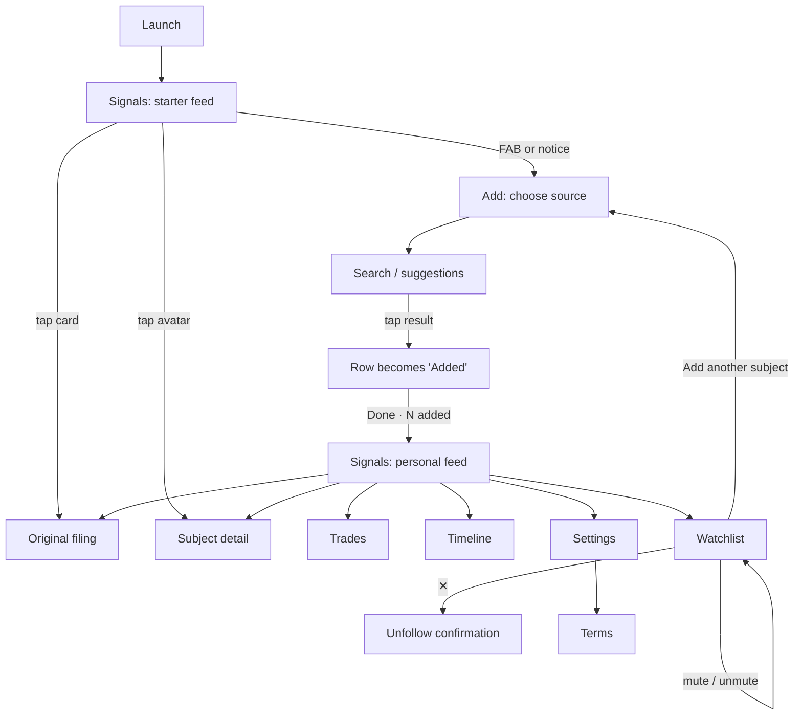

# Ripple — UI/UX Specification

A self-contained brief for designing or building Ripple's interface. It assumes no prior context. Where something is described as **[built]**, it exists in the current app; **[not built]** marks intended behaviour the app does not have yet. Don't treat a [not built] item as a bug in someone else's work. It is open design scope.

---

## 1. Product

Ripple is a mobile app (React Native + Expo, iOS/Android/web) that reads **public disclosure records** and merges them into one reverse-chronological feed:

| Source | What it is | Colour (dark) |
|---|---|---|
| **Congress** | STOCK Act trade disclosures filed by members of Congress | `#C084FC` purple |
| **Insiders** | SEC Form 4 filings: executives and directors trading their own stock | `#F59E0B` amber |
| **Policy** | Executive orders and proclamations as they are signed | `#5B8DEF` blue |
| **Stocks** | Price moves and volume spikes for tickers you track | `#3FD68C` green |

The user should be able to answer three questions quickly: *What public action just happened? Who or what should I follow next? What did the relevant stock do afterwards?*

**Promise:** public records plus descriptive price context in a calm interface that makes each item's source clear. Ripple **describes, never predicts or advises**. There are no accounts and no onboarding carousel, and all data stays on the device.

**Primary user:** someone who follows markets and wants a fast, factual view of disclosures without checking several government and market-data sites.

**Sources are data-driven.** The four sources come from a provider registry, in the order Congress, Insiders, Policy, Stocks. Picker tiles, filter chips, badges and counts are generated from it. Never hardcode four sources into a reusable component; a fifth must be able to appear without a redesign.

---

## 2. Experience principles

1. **Show value before asking for setup.** Launch straight into a populated starter feed.
2. **Always show where data came from.** Every signal shows its source and opens the original record.
3. **Dense but scannable.** Strong hierarchy, short metadata lines, quiet hairline dividers, no decorative chrome.
4. **Colour means something.** Colour appears only for a source's identity, for a direction (up/down) and for the one primary accent. Everything else is neutral.
5. **Be honest about state.** Live, sample/offline, stale, loading, missing price data and error states must each look different. Sample data must never look live.
6. **Keep control local and reversible.** Muting is not deleting. Destructive actions are confirmed.
7. **Never look like a trading app.** No buy/sell calls to action, no "opportunity" styling, no portfolio framing. Disclosed trades are **past** events, not current holdings. (Store-review risk: Apple guideline 3.2.1(viii).)

---

## 3. Information architecture

**Tabs** (bottom tab bar, in this order):

| Tab | Header title | Icon (Ionicons) | Purpose |
|---|---|---|---|
| Signals | "Ripple" | `pulse` | Merged feed, grouped by day |
| Trades | "Trades" | `swap-horizontal` | Trade signals only, plus "Top holdings" |
| Timeline | "Timeline" | `git-commit-outline` | Source activity on a shared time axis |
| Watchlist | "Watchlist" | `list` | Followed subjects, grouped by source |

Every tab header has back/forward nav controls on the left and a settings button on the right.

**Stack screens:**

| Screen | Route | Reached from |
|---|---|---|
| Add a subject (source picker) | `/add` (native modal) | FAB on Signals, starter notice, empty-state button, Watchlist footer |
| Subject search | `/add/[source]` | Source tile |
| Subject detail | `/subject/[source]/[handle]` | Card avatar, Watchlist row |
| Settings | `/settings` | Header settings button |
| Terms | `/terms` | Settings › About |
| Backup & Restore | `/backup` | **[not built]** No entry point links to it yet |
| Privacy | `/privacy` | **[not built]** No entry point links to it yet |

**Filings** open in the system browser sheet on native (page sheet with a themed toolbar) and in a new tab on web. There is **no** custom in-app reader. **[not built]:** an "In app / Browser" preference exists in storage but has no UI.

---

## 4. Golden path: follow a first subject

This must be doable in **four decisions: Add → source → result → Done.**

1. **Launch into Signals (starter feed).** It shows sample subjects from each source. A **starter notice** band above the feed reads, for screen readers: *"Starter feed. These are sample subjects from each public source, not a watchlist of your own. Double tap to follow your first subject."* Cards already work: they open filings and subjects. There are two ways to add: the notice and the **FAB** (56pt circle, bottom right).
2. **Source picker (modal).** One tile per source, two per row, in registry order. Each tile shows its icon, label, one-line description (the text in the §1 table), a provenance tag and a followed count.
3. **Subject search.** Search autofocuses on entry and results are debounced. Placeholders:
   - Congress: `Name, district, or a party`
   - Insiders: `Company or ticker`
   - Policy: `Topic, or pick a document type`
   - Stocks: `Ticker or company name`

   With an empty query, suggestions show: party groups for Congress ("All members", "Republicans", "Democrats", "Independents"), companies, document types, and popular tickers.
4. **Add.** Tapping a result turns that row, in place, into a disabled **`Added`** state (tag in `up` colour), with a success haptic and a screen-reader announcement. A persistent bottom bar reads **`Done · N added`**, so several subjects can be added without leaving the screen.
5. **Done** returns to Signals. The starter set is replaced by the user's own subjects. There is no separate success page.

---

## 5. Supporting flows

**A. Read a signal [built]**
- A card shows: avatar · name · subtitle · time · source badge; then one sentence of body text; then a **value chip** (for example `▲ +$50K`) and record badges (for example `TRADE DISCLOSURE`).
- Tapping the card body opens the filing (with a light haptic). Tapping the avatar or name opens subject detail. These two are **sibling** tap targets, never one nested inside the other.
- Long-pressing a card opens a native action sheet (iOS) or alert (Android) with: `Open filing`, `More from {name}`, `Share`, `Cancel`.

**B. Narrow the feed**
- **[built]** Filter chips, one per source, each with a count. Tapping one hides or shows that source; the choice persists between sessions. Filtering applies to already-loaded data, so it is instant.
- **[not built]** Text search, Buys/Sells filter, time range (Any/7D/30D/90D), results summary and a "Clear filters" action.
- Each empty result needs its own explanation: every source hidden, no subjects followed, or no signals yet.

**C. Subject detail [built]**
- Header: 56pt avatar, name (`title` type), subtitle.
- Not followed: a **`Follow`** button. Followed: two icon buttons, **mute/unmute** (a bell icon, acting as a switch) and **unfollow** (person-remove icon). Unfollowing asks for confirmation.
- Shows the subject's signal history. A timeline appears only when there are **at least 4 signals**.

**D. Watchlist [built]**
- Sections are grouped by source, each with a header and count. A row has three sibling targets in a non-interactive container:
  - the row body, which opens detail;
  - a **mute** switch (bell / bell-off in `warning` colour; the row gains a `MUTED` tag);
  - an **unfollow** `✕`.

  The two action buttons are real 44×44 boxes because they sit 8pt apart.
- Unfollow confirmation says: *"Their signals will be removed from your feed. You can add them again any time."*, with `Cancel` and `Unfollow`.
- The list ends with **Add another subject**.
- When empty: an empty state with an `Add a subject` button.

**E. Trades [built]:** trade signals only.
- Each card shows trader, BUY/SELL, asset (with logo), disclosed amount, date, and return or timing context when it is available.
- **Top holdings** ranks assets by how many distinct people disclosed them. It must not suggest these are current positions.

**F. Timeline [built]**
- One lane per source. Markers are **▲ for up, ▼ for down, and a circle for no single direction**. A numbered cluster means several filings within a few days.
- Ranges: `30D`, `90D` (default), `1Y`, `All`.
- Tapping a marker opens its lead filing. Below the lanes are a legend and the **latest 5** cards.

**G. Settings**
- **[built]**
  - **Profile:** Theme (`System` / `Dark` / `Light`), Gains and losses (`Classic` red-green / `Accessible` teal-orange, with colour swatches), Group the feed by day (switch), Haptic feedback (switch).
  - **Sources:** each source's provenance mode and followed count.
  - **Data:** subjects followed, paused, signals cached, last refreshed, refresh interval (read-only: "Every 10 minutes, while open"), and **Clear cached signals** (confirmed; the watchlist is kept; afterwards it says *"Cleared. Pull to refresh on the Signals tab to refill."*).
  - **About:** description, the visible disclaimer **"Not investment advice. …"**, Terms, and links to House Clerk, SEC EDGAR and Federal Register.
- **[not built]**
  - Controls for Open on (start tab), Refresh interval, and Filings open (In app / Browser). These preferences exist in storage.
  - Links to Backup & Restore and Privacy.
  - Reset to defaults.

**H. Backup & Restore [screen built, unreachable]**
- Produces a selectable text backup of the watchlist, with a share-sheet button.
- Paste to restore: the text is validated as it is typed and a preview shows valid / duplicate / invalid entries.
- Restoring **only adds** missing subjects and never removes any. The result counts are announced.

---

## 6. Screen × state matrix

Every state must be designed, not implied.

| Screen | States |
|---|---|
| Signals, starter | loading, populated sample, refresh error, offline sample |
| Signals, personal | populated, filtered, "N new signals" pill, stale cache, no matches, no signals |
| Source picker | live, keyed/offline source, follow counts |
| Subject search | suggestions, typing, loading, results, added, no match, connection error |
| Card action sheet | default |
| Subject detail | loading, followed, not followed, muted, error, empty history, with/without timeline |
| Trades | populated, starter, empty, error |
| Timeline | each range, cluster, empty, error |
| Watchlist | grouped, muted row, empty, unfollow confirmation |
| Settings | defaults, changed, clear-cache confirmation, cleared |
| Backup | empty watchlist, backup ready, invalid paste, valid preview, restored result |

**Global behaviour**
- **Hydrating:** show a centred spinner. Never flash a wrong empty state.
- **Refreshing:** keep the content visible and show the pull-to-refresh spinner.
- **Refresh failed:** cached content stays usable. A dismissible amber bar with a warning icon reads `Couldn't refresh {handle}` or `Couldn't refresh {N} subjects`; screen readers hear "…Showing saved signals."
- **New content while scrolled down:** a floating `N new signals` pill (accent fill, near the top). Tapping it scrolls to the top, and its appearance is announced.
- **Provenance tags**, exact text only: `LIVE · KEYED`, `LIVE · NO KEY`, `OFFLINE SAMPLE`. Don't paraphrase them.
- **Missing price data:** leave it out or label it as missing. Never show a misleading zero.
- **Destructive actions:** use a native confirmation dialog that names the consequence and offers a safe Cancel.
- **Navigation memory:** coming back from detail or a filing keeps the tab, filters and scroll position.
- **Day headers** are **not sticky**; a sticky header would cover its own card on a day with few items.

---

## 7. Visual system

**Dark is primary** (the app default; "System" falls back to dark). Design dark first, then check light. There are four palettes: {dark, light} × {classic, accessible}. Accessible mode changes **only** up/down.

### Colour tokens

| Role | Dark | Light | Use |
|---|---|---|---|
| `bg` | `#0B0E13` | `#F6F8FC` | Screen, feed cards, headers, tab bar |
| `surface` | `#141922` | `#FFFFFF` | Raised cards (settings); pressed rows |
| `surfaceAlt` | `#1C2230` | `#E9ECF3` | Badges, count pills, the off track of a switch |
| `border` | `#252C3B` | `#DCE1EB` | Hairline dividers (deliberately faint) |
| `text` | `#E9EDF5` | `#141A26` | Primary text (16.5:1) |
| `textMuted` | `#8D97AB` | `#525967` | Metadata: handles, times, counts (6.6:1) |
| `textSubtle` | `#757E92` | `#646D7E` | Dimmest informative text, **on `bg` only** (4.8:1; fails on `surface` in dark) |
| `textFaint` | `#5C6579` | `#7C879C` | **Decoration only** (3.3:1, fails AA) |
| `accent` | `#5B8DEF` | `#2457D6` | Primary action, selection, active tab |
| `onAccent` | `#0B0E13` | `#FFFFFF` | Text on any solid fill |
| `up` | `#3FD68C` | `#067647` | Gains/buys |
| `down` | `#F2545B` | `#C4262E` | Losses/sells |
| `warning` | `#E8B23A` | `#9A6206` | Muted/offline/error, **always with an icon or a word** |
| `logoPlate` | `#F5F7FA` | `#F5F7FA` | Plate behind transparent logos (the same in both themes) |

**Accessible tones:** up `#2DD4BF` / `#0F766E`, down `#FF6B47` / `#C2410C` (dark / light).

**Source colours on light:** the bright source colours fail contrast on the light background (1.8–3.0:1). In light mode, solid source fills use `#7E3AF2` (Congress), `#B45309` (Insiders), `#2457D6` (Policy) and `#067647` (Stocks), with white text. Don't draw the bright colours as text or icons on light.

**Tints:** chips and badges use their own colour at low alpha, usually **0.16**. A label in colour X on a tint of X must still measure ≥4.5:1. In light mode that currently fails (≈4.2:1), so prefer a neutral chip or a solid fill there.

### Direction is never colour alone (WCAG 1.4.1)
- Value chips: `▲ +$50K` / `▼ −$15K`.
- Timeline: ▲ / ▼ triangles or a circle.
- Screen readers hear "Up, +$50K".
- Skip the glyph when the label already says BUY or SELL.
- `warning` never appears as a bare chip or next to a `down` chip.

### Typography: platform system font (SF / Roboto), no custom fonts

| Level | Size/weight/tracking | Line height | Use |
|---|---|---|---|
| title | 20/700/−0.3 | — | One per screen, EmptyState title |
| heading | 16/700/−0.2 | — | Stack headers, feed day headers |
| body | 15/400 | 21 | **The card's sentence**; never chrome |
| bodyTight | 14/400 | 19 | Settings rows, legal copy |
| label | 13/600 | — | Names, **all button labels** |
| caption | 12/400 | — | Timestamps, counts, help text |
| micro | 11/600/+0.3 | — | Chips, pills, uppercase section labels |
| tag | 10/700/+0.4 | — | Uppercase stamps only (`MUTED`, `TRADE DISCLOSURE`) |

- **10pt is the minimum** text size.
- Text scales with the system setting, so never give text containers a fixed height.
- Uppercase is applied where the text is used, not in the type style.
- The only other family is monospace, for the backup code block.

### Layout
- **Spacing:** 4 · 8 · 12 · 16 · 24 · 32.
  - Gutter 16; row padding 12 vertical, with a hairline between rows (no gap).
  - Inside a card: 12 between avatar and body, 4 between lines, 8 between chips.
  - Section header: 24 above, 8 below.
  - Feed bottom padding: 96, to clear the FAB.
- **Touch targets:** at least 44×44. Icons are drawn at 32–38 and padded out.
- **Frames:** single column, phone only. Design at **390×844**; check **320** and **430**.

### Shape and depth
- **Radius:**
  - 6: small tags, icon-only badges
  - 10: inputs, company avatars
  - 14: cards, tiles
  - pill: chips, buttons, FAB
- Hairlines divide; a 1px border outlines a chip or tile.
- **Avatars:** people are **circles**; companies and tickers are **squares** (radius 10). Logos are fitted onto the plate, portraits are cropped.
- **Flat:** depth comes from `bg` → `surface` → `surfaceAlt` plus hairlines. Only the **FAB** and the **new-signals pill** have shadows. There are no scrims, bottom sheets or custom modals; use native alerts and action sheets.
- **Motion: none.** Press feedback is instant: rows turn `surface`; raised controls go to opacity 0.85 and scale 0.96. Haptics mark actions. Any future animation must respect the OS reduce-motion setting.
- **Icons:** Ionicons only.

### Key component recipes
- **FilterChip:**
  - On: a solid source fill with `onAccent` icon, label and count, and a count pill at 0.2 white/black wash.
  - Off: transparent, `border` outline, `textMuted` content. Pill shape, 11pt label.
- **Primary button:** `accent` fill, `onAccent` label (13/600), pill, padding 12×24.
- **Choice pill (settings):** `surfaceAlt` with `textMuted` text. When selected: `accent` at 0.16 fill, `accent` border and text. It is a radio button.
- **Settings card:** `surface`, radius 14, hairline border. Rows inside have 16/12 padding and hairlines on top.
- **EmptyState:**
  - a 56pt icon ring (accent at 0.12);
  - a title;
  - body text in `textMuted`, centred, max width 300;
  - an optional primary button.

---

## 8. Accessibility requirements

- Every control has a role, a label that names the result, and a state.
- Toggles are `switch` with `checked`. Single choices are `radio` with `aria-checked`.
- **Never nest tappable elements.** On web a nested one renders as a button inside a button. Put them side by side in a non-interactive parent.
- Anything shown only visually (source, direction, count, status) goes into the accessible label. Decorative badges are hidden from screen readers.
- A card, notice or day header is **one** accessible element with a full-sentence label.
- Announce new-signal counts, add success, refresh failure, validation results and restore results through live regions.
- Contrast: at least 4.5:1 for text; at least 3:1 for large text and control boundaries. Check both themes and both tone modes.
- Support Dynamic Type/font scaling, keyboard navigation and visible focus on web, and reduced motion.

---

## 9. Content rules

- **Verbs match the action:** `Follow`, `Unfollow`, `Mute`/`Unmute`, `Open filing`, `Add a subject`, `Done · N added`, `Clear cached signals`.
- **Describe, don't predict:** "rose 3.2% after filing", never "likely to rise".
- Keep **"Not investment advice"** visible in the app, not only in the legal pages.
- Use illustrative (not real-looking) names, tickers, dates and amounts in mockups.

---

## 10. Deliverables (if prototyping)

A clickable 390×844 prototype showing the complete golden path, plus return navigation that keeps context. Include light and dark versions of at least Signals, the source picker and subject detail. Frames:

1. Signals starter feed
2. Source picker
3. Subject search with suggestions
4. Subject search after adding two
5. Personal feed
6. Filtered feed with no matches
7. Card action sheet
8. Subject detail (followed, muted)
9. Trades
10. Timeline with a cluster
11. Watchlist with active and muted rows
12. Unfollow confirmation
13. Settings
14. Refresh-error and new-signals states
15. Backup & Restore preview

## 11. Acceptance checklist

- [ ] The starter feed shows value with no signup or slides.
- [ ] A first follow takes ≤4 decisions.
- [ ] Every signal shows its source and a path to the original record.
- [ ] Loading, empty, stale, offline, error and success states are all designed.
- [ ] Mute and unfollow are visually and semantically distinct.
- [ ] Nothing implies a disclosed trade is a current holding or a recommendation.
- [ ] Up/down never relies on colour alone.
- [ ] Contrast, 44pt targets, screen-reader semantics and text scaling pass in all four palettes.
- [ ] A new source can be added through the registry with no component redesign.
- [ ] Light and dark both keep the dense, quiet aesthetic where each item's source is clear.

## 12. Known defects in the current build (don't copy)

1. The logo plate uses `text` instead of `logoPlate`, so logos sit on near-black in light mode.
2. The feed value chip (tone text on a 0.16 tint) measures ~4.2:1 in light mode, below AA.
3. Bright source colours are used as text and icons on light in five places. Only the filter chips use the darker light fills.
4. `textSubtle` sits on `surface` cards in dark mode (4.33:1).
5. The refresh-error bar has a hardcoded dark-amber background that doesn't adapt to light mode.
6. Two text sizes are below the minimum: 9pt on the feed headline pill, 8pt on the timeline cluster count.
7. Backup & Restore and Privacy exist but nothing links to them.
