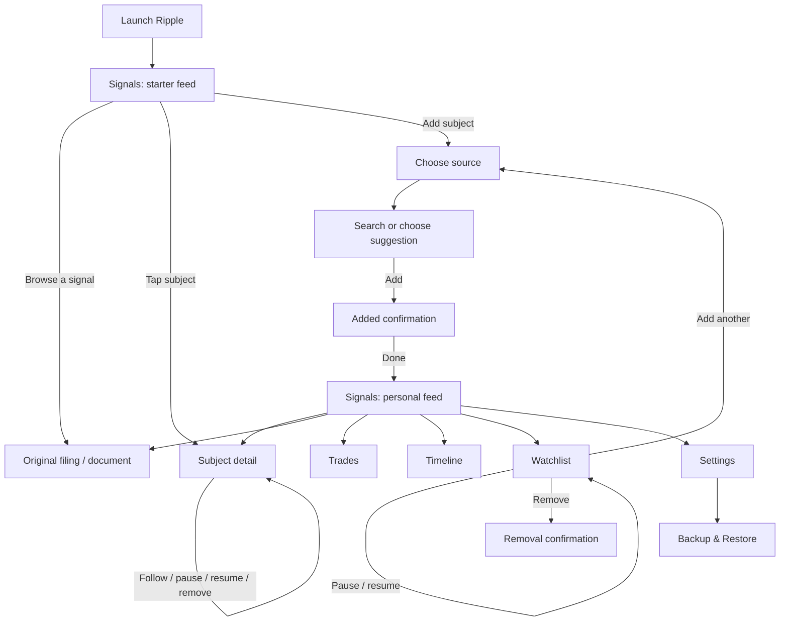

# Ripple OpenDesign User-Flow Brief

> Flows and states only. Visual tokens and rules live in [`DESIGN.md`](../DESIGN.md) at the repo root, and that file wins where the two disagree.

## 1. Design Mission

Design a mobile-first experience that lets someone answer three questions quickly:

1. **What market-moving public action just happened?**
2. **Who or what should I follow next?**
3. **What did the relevant stock do afterward?**

Ripple combines congressional trade disclosures, SEC Form 4 insider filings, federal policy documents, and tracked stock moves into one reverse-chronological feed. It has no account or onboarding carousel. A useful starter feed introduces the product immediately; following a first subject turns it into a personal feed.

**Primary user:** a market-aware person who wants a fast, factual view of public disclosures without manually checking several government and market-data sites.

**Product promise:** public records and descriptive price context in one calm, source-aware interface. Ripple describes events; it does not predict outcomes or provide investment advice.

## 2. Experience Principles

- **Show value before asking for setup.** Open directly to a populated starter feed.
- **Make provenance visible.** Every signal identifies its source and can open the original filing or document.
- **Keep dense information scannable.** Use strong hierarchy, short metadata rows, and quiet dividers rather than decorative chrome.
- **Reserve colour for meaning.** Source colour, status, and price movement should be easy to spot; neutral UI stays subdued.
- **Be honest about state.** Clearly distinguish live data, sample/offline data, stale cached data, loading, missing price context, and errors.
- **Keep control local and reversible.** Watchlist, preferences, and backups are device-local. Pausing a subject must not imply deletion.
- **Do not hardcode the source set in reusable UI.** Source tiles, filters, badges, and counts are generated from the provider registry.

## 3. Information Architecture

**Primary tabs**

| Tab | Purpose | Primary action |
|---|---|---|
| Signals | Merged, reverse-chronological disclosure feed | Filter, search, or add a subject |
| Trades | Trade-only view plus top disclosed holdings | Open a trade filing |
| Timeline | Compare source activity across time | Change range or inspect a cluster |
| Watchlist | Manage followed and paused subjects | Add, pause, resume, or remove |

**Stack and modal destinations**

| Destination | Route | Entry points |
|---|---|---|
| Source picker | `/add` | Add button, FAB, empty-state CTA |
| Subject search | `/add/[source]` | Source tile |
| Subject detail | `/subject/[source]/[handle]` | Avatar, subject name, watchlist row |
| Settings | `/settings` | Header settings button |
| Backup & Restore | `/backup` | Settings > Data |
| Privacy | `/privacy` | Settings > About |
| Terms | `/terms` | Settings > About |
| Filing browser | In-app modal on native; external tab on web | Signal or trade card |

## 4. Golden Path — Follow a First Subject

This is the primary prototype flow OpenDesign should make fully clickable.

1. **Launch into Signals**
   - Show a sample from each available source and a compact explanation that this is a starter feed.
   - Keep the feed usable: cards can open their source document and subjects can open detail.
   - Provide two clear add entry points: the starter notice and the floating add button.
2. **Open the source picker**
   - Present one registry-driven tile per source in this order: Congress, Insiders, Policy, Stocks.
   - Each tile includes its label, icon, colour, one-line description, provenance, availability state, and followed count.
   - Include a short note that Ripple uses public data and does not require an account.
3. **Choose a source**
   - Congress: “STOCK Act trade disclosures filed by members of Congress.”
   - Insiders: “Form 4 filings — executives and directors trading their own stock.”
   - Policy: “Executive orders and proclamations as they are signed.”
   - Stocks: “Price moves and volume spikes for tickers you track.”
4. **Search or choose a suggestion**
   - Autofocus search on entry and debounce results.
   - Empty-query suggestions may include parties for Congress, companies for Insiders, document types/topics for Policy, and popular tickers for Stocks.
   - Search placeholders:
     - Congress: `Name, district, or a party`
     - Insiders: `Company or ticker`
     - Policy: `Topic, or pick a document type`
     - Stocks: `Ticker or company name`
5. **Add a result**
   - The tapped row changes in place to a disabled `Added` state.
   - A persistent bottom action reports `Done · N added`, allowing multiple additions without leaving search.
6. **Finish**
   - Return to Signals.
   - Replace the starter set with the user's followed subjects after their first real follow.
   - Confirm the change through visible feed content and a polite accessibility announcement; do not add a separate success page.

## 5. Core Supporting Flows

#### A. Read and Verify a Signal

1. Scan source badge, actor, action summary, timestamp, and price context.
2. Tap the card body to open the original filing/document.
3. On native, show an in-app browser with Close, page title/host, loading progress, and Open in browser.
4. If loading fails, show `Try again` and `Open in browser` without losing the feed position.
5. On web, open the source in a new browser tab because some public sites block embedding.

**Alternate actions:** tapping the avatar opens subject detail. Long-pressing a card opens a sheet with `Open filing`, `More from [subject]`, `Share`, and `Cancel`.

#### B. Narrow the Signals Feed

1. Toggle registry-driven source filter chips; each chip displays a count.
2. Search people, tickers, or filings.
3. Optionally choose transaction type (`All`, `Buys`, `Sells`) and time range (`Any`, `7D`, `30D`, `90D`).
4. Show a short results summary and a clear-all action whenever filtering is active.
5. Preserve hidden-source choices between sessions.

**Empty outcomes must explain the cause:** no search matches, all relevant sources hidden, no followed subjects, or no signals returned yet.

#### C. Explore and Manage a Subject

1. Enter from a feed avatar/name or watchlist row.
2. Show subject identity, source, metadata, and deeper signal history.
3. Show the timeline only when at least four signals exist.
4. If not followed, offer `Follow`.
5. If followed, offer `Pause updates` / `Resume updates` and `Remove from watchlist`.
6. Confirm removal and state that cached signals for that subject will be removed but the subject can be added again.

#### D. Manage the Watchlist

1. Group rows by source and show group counts.
2. Tap a row to open subject detail.
3. Use a labelled eye switch to pause/resume updates. A paused row remains visible but does not contribute new feed items.
4. Use a separate, non-nested remove action and require confirmation.
5. End the list with `Add another subject`.

When empty, explain that the starter feed is active and show `Add a subject`.

#### E. Compare Activity

- **Trades:** show only structured trade signals. Cards display trader, action, asset, disclosed amount, transaction date, and available return/timing context. `Top holdings` ranks disclosed transactions across distinct people and must not imply current portfolio positions.
- **Timeline:** show source activity on shared lanes. Support `30D`, `90D`, `1Y`, and `All`; default to `90D`. A single dot opens its lead filing, while a numbered cluster communicates multiple events. Include a source legend and the latest five event cards.

#### F. Configure the App

Settings includes:

- Theme: `System`, `Dark`, `Light`
- Open on: `Signals`, `Trades`, `Timeline`, `List`
- Refresh: `5 min`, `10 min`, `30 min`, `Manual`
- Filings open: `In app`, `Browser` (web always uses a new tab)
- Daily digest toggle
- Haptics toggle
- Source provenance, connection mode, and followed counts
- Device-local counts for followed, paused, and cached items, plus last refresh time
- Backup & Restore, Clear cached signals, Privacy, Terms, and external project links

`Reset to defaults` must require confirmation and leave the watchlist and cache untouched. `Clear cached signals` must also require confirmation, keep the watchlist, and explain that the feed refills on refresh.

#### G. Backup and Restore

1. Generate a selectable, text-based backup when the watchlist is non-empty.
2. Offer `Send backup` through the system share sheet.
3. Accept pasted backup text and validate it live.
4. Before restoring, show a preview of valid subjects, duplicates, and invalid entries.
5. Restore by adding valid missing subjects only; never remove or replace the current watchlist.
6. Announce the result and show counts for added, skipped, and invalid items.

## 6. Screen and State Matrix

| ID | Screen | Required states | Key exits |
|---|---|---|---|
| S01 | Signals — starter | Loading, populated sample, refresh error, offline sample | Add, filing, subject, settings, tabs |
| S02 | Source picker | Live sources, keyed/offline source, following counts | Search, dismiss |
| S03 | Subject search | Suggestions, typing, loading, results, added, no match, connection error | Done, back |
| S04 | Signals — personal | Populated, filtered, new-signal pill, stale cache, no matches, no signals | Filing, subject, add, tabs |
| S05 | Signal actions | Default action sheet | Filing, subject, share, cancel |
| S06 | Subject detail | Loading, followed, not followed, paused, stale error, empty history | Follow/manage, filing, back |
| S07 | Trades | Populated, starter, empty, stale error | Filing, add, tabs |
| S08 | Timeline | Populated ranges, clustered events, empty, stale error | Filing, tabs |
| S09 | Watchlist | Grouped, paused row, empty, removal confirmation | Subject, add, tabs |
| S10 | Settings | Defaults and changed preferences, reset confirmation, clear-cache confirmation | Backup, legal pages, back |
| S11 | Filing browser | Loading, loaded, navigation-back available, failed | Close, retry, external browser |
| S12 | Backup & Restore | Empty list, backup ready, invalid paste, valid preview, restored result | Share, restore, back |

## 7. Global State Behaviour

- **Hydrating:** use a centred progress indicator; do not flash an incorrect empty state.
- **Refreshing:** preserve visible content while showing pull-to-refresh progress.
- **Stale/error:** keep cached content usable and show a dismissible banner such as `Couldn't refresh [source] — showing what we have.`
- **New content:** if the user is away from the top, show a floating `N new signals` pill. Activating it scrolls to the top; announce its appearance to assistive technology.
- **Offline/sample:** label sample data plainly and never make it look live.
- **Unavailable price data:** omit or label the context; never substitute a misleading zero.
- **Destructive action:** use a confirmation dialog with a specific consequence and a safe cancel action.
- **Navigation memory:** returning from a detail or filing should preserve tab, filters, and scroll position.

## 8. Component and Content Rules

- Signal cards have two sibling interaction targets: subject identity opens detail; card body opens the filing. Do not make one interactive element a child of the other.
- Keep source identity consistent across picker tiles, filter chips, cards, timelines, and watchlist sections:
  - Congress: purple `#C084FC`
  - Insiders: amber `#F59E0B`
  - Policy: blue `#5B8DEF`
  - Stocks: green `#3FD68C`
- Use verbs that describe the actual action: `Follow`, `Pause updates`, `Resume updates`, `Remove`, `Open filing`, `Clear filters`.
- Avoid predictive language. Prefer “rose 3.2% after filing” over “likely to rise.”
- Keep “Not investment advice” visible in an appropriate low-emphasis location without hiding it behind legal pages.
- Use the `textMuted` token for normal secondary copy. `textFaint` is decorative only because it does not meet AA contrast for normal text.
- Do not use fixed-height text containers or aggressive line clamping where larger text could obscure critical content.

## 9. Accessibility Requirements

- Every interactive control needs a descriptive accessibility label, role, and state.
- Switches use role `switch` and expose checked state. Example: `Pause updates for Apple, on`.
- Icon-only controls must have a minimum effective target of 44x44px and a label that names the result, not the icon.
- Never nest buttons or Pressables. Place row navigation, pause/resume, and remove controls as siblings inside a non-interactive container.
- Add source, status, transaction direction, and price movement to the accessible name whenever colour or a visual badge carries that information.
- Use live-region announcements for new-signal count, add/follow success, refresh failure, validation messages, and restore results.
- Support screen readers, Dynamic Type, keyboard navigation on web, visible focus, reduced motion, and both light and dark themes.
- Maintain at least 4.5:1 contrast for normal text and 3:1 for large text and essential graphical controls.

## 10. OpenDesign Deliverables

Create a cohesive, clickable mobile prototype using a **390x844px primary viewport**, then verify layouts at **320px** and **430px** widths. Include light and dark theme examples for at least Signals, the source picker, and subject detail.

Deliver these linked frames:

1. Signals starter feed
2. Source picker
3. Subject search with suggestions
4. Subject search after adding two items
5. Personalized Signals feed
6. Filtered Signals feed with no matches
7. Signal long-press action sheet
8. Subject detail — followed
9. Trades
10. Timeline with a multi-event cluster
11. Watchlist with active and paused rows
12. Watchlist removal confirmation
13. Settings
14. Filing browser loading and failure states
15. Backup & Restore validation and preview

Use realistic but clearly illustrative names, tickers, dates, and disclosure amounts. The prototype must demonstrate the complete golden path from starter feed to a personalized feed, plus return navigation that preserves context.

## 11. Acceptance Checklist

- [ ] The starter feed communicates immediate value without signup or onboarding slides.
- [ ] A first-time user can follow a subject in no more than four decisions: Add, source, result, Done.
- [ ] Every signal visibly identifies its source and offers a path to the original record.
- [ ] Loading, empty, stale, offline, error, and success states are designed rather than implied.
- [ ] Pausing and removing are visually and semantically distinct.
- [ ] Filters remain comprehensible when several are active and can be cleared in one action.
- [ ] Designs do not imply that disclosed trades are current holdings or investment recommendations.
- [ ] Interactive targets, contrast, screen-reader semantics, focus, and text scaling meet the accessibility requirements above.
- [ ] New sources can be added through the provider registry without redesigning shared components.
- [ ] Light and dark themes retain the dense, quiet, source-led Ripple aesthetic.
