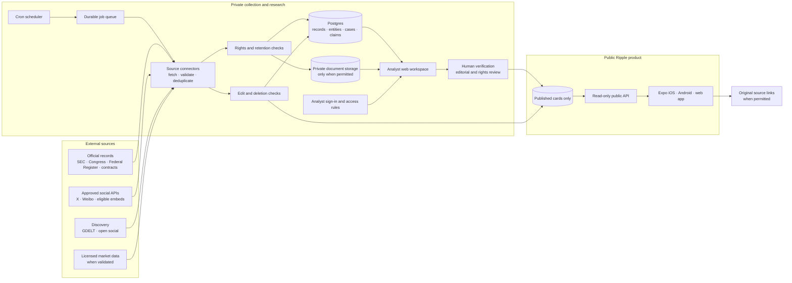

#### Ripple Technical Stack And High-Level Architecture

- NOTE: Proposed architecture as of **18 September 2026**. This is a design for the research workspace, public records, and selective social coverage described in [Ripple Research Sources And Workspace Report](Social%20Content%20API%20And%20Store%20Feasibility.md). It is not yet implemented.
- **Decision:** Keep Ripple's **Expo/React Native/TypeScript** mobile app. Add a private web research workspace and a small server-side ingestion and publication layer. Publish reviewed event cards to the mobile app; keep raw or licensed source material in the private layer under its source-specific rules.
- **Design boundary:** The mobile app reads only approved public cards and permitted post displays. Analyst notes, unresolved matches, credentials, raw licensed content, and moderation records stay private.

#### What Exists Today

| Layer | Current Ripple implementation | Keep or change |
|---|---|---|
| Mobile and web app | **Expo 57**, **React Native 0.86**, **React 19**, **TypeScript**, and **Expo Router**. [Project dependencies](../package.json) | Keep for the consumer app. Expo Router supports native and web navigation. [Expo documentation](https://docs.expo.dev/router/introduction/) |
| Client state | **Zustand** for feed and watchlist state; **AsyncStorage** for device persistence. [Project dependencies](../package.json) | Keep for UI and device preferences. Do not store provider secrets or indefinite licensed social content on device. |
| Source integration | Four client-side providers normalize House filings, SEC Form 4, Federal Register records, and stock context into a shared **Signal** shape. [Provider contract](../src/providers/types.ts) · [Source overview](../README.md) | Keep the provider interface for the current feed. Add server-backed providers as sources migrate; use separate evidence and claim models in the backend. |
| Verification | TypeScript typecheck and Node's built-in test runner. [Project scripts](../package.json) | Keep; add ingestion, access-control, and publication checks when the backend exists. |

#### Recommended Stack

| Component | Choice | Purpose and reason |
|---|---|---|
| Consumer app | Existing **Expo + React Native + Expo Router + TypeScript** | Reuse the shipped UI and provider pattern. The app should show published cards, watchlists, timelines, and source links. Use [EAS Build](https://docs.expo.dev/build/setup/) for store binaries when release-ready. |
| Analyst workspace | **Next.js App Router + React + TypeScript** | A separate desktop-oriented interface for dense filings, side-by-side evidence, entity matching, review, and correction history. Next.js provides server-rendered pages and request handlers. [Next.js App Router](https://nextjs.org/docs/app) · [Route handlers](https://nextjs.org/docs/app/getting-started/route-handlers) |
| Database | **Supabase Postgres** | Store cases, source metadata, entities, evidence links, claims, review decisions, published cards, licence rules, and audit events. Use stable source IDs and uniqueness constraints for deduplication. |
| Identity and authorization | **Supabase Auth + Postgres row-level security** | Give analysts, editors, and administrators separate permissions. Keep the consumer app anonymous initially. Apply grants and policies to every exposed table; a public role may read published cards only. [RLS guidance](https://supabase.com/docs/guides/database/postgres/row-level-security) |
| Public read API | **Supabase Edge Function** or a small server endpoint | Return only approved, current cards and allowed fields to the app. The endpoint becomes the control point for takedowns, caching, pagination, and versioned response shapes. |
| Collection schedule | **Supabase Cron** | Trigger bounded checks of SEC, Federal Register, procurement, and approved social sources. Cron can invoke an Edge Function. [Cron documentation](https://supabase.com/docs/guides/cron) |
| Job handoff | **Supabase Queues** | Buffer source checks, retries, normalization, and deletion checks without tying them to a user request. Make each job idempotent using platform plus native record ID. [Queues documentation](https://supabase.com/docs/guides/queues) |
| Ingestion workers | **TypeScript Edge Functions** for short API jobs; an isolated container worker only if OCR or large backfills require it | Keep routine collection small and operationally simple. Add heavier infrastructure only when scanned PDFs or data volume justify it. Human-check OCR fields before public use. |
| Document storage | **Private Supabase Storage buckets** | Hold documents and extracts only where source terms allow; keep metadata and citations in Postgres. Apply storage access policies and deletion schedules. [Storage access control](https://supabase.com/docs/guides/storage/security/access-control) |
| Search | **Postgres full-text search** first | Search cases, entities, citations, and permitted document text without operating a separate search cluster. Add semantic/vector search only after measured search gaps. [Full-text search guidance](https://supabase.com/docs/guides/database/full-text-search) |
| Runtime validation | **Zod** schemas at ingestion and API boundaries | Reject malformed upstream data, make missing fields explicit, and share published-card contracts across mobile, web, and server TypeScript. This would be a new dependency. |
| Observability | Structured ingest-run records, job failures, source health, spend and rate-limit alerts | Show freshness, failures, duplicate rates, takedown lag, and API cost in an internal dashboard before adding a paid monitoring service. |

- NOTE: [Supabase pricing](https://supabase.com/pricing) currently lists a Free tier for experiments and Pro **from US$25/month**. That is an infrastructure starting point, not the full cost of workers, document processing, storage, traffic, paid source reads, or staff review.
- NOTE: A separate Next.js workspace is recommended when analysts need document-heavy workflows. The first local case prototype can remain inside the current Expo web app to validate the workflow before adding a second frontend.

#### High-Level Architecture

- **Trust boundary:** Only the reviewed card store crosses from private research to the public API. A social post that has not been licensed for display remains a lead or source link, not a copied public-feed item.
- **Correction path:** The edit/deletion checker flags changed upstream material, updates the case, and withdraws or revises an affected published card. The public API then stops returning stale text.

#### Core Data Model

| Record | Minimum fields | Why |
|---|---|---|
| **Source item** | Provider, native ID, original URL, source type, event time, publication time, retrieval time, content hash, expiry and removal status | Supports deduplication, provenance, freshness, and takedowns. |
| **Entity** | Legal name, aliases, ticker, CIK, ABN/ACN or other registry ID, match status | Connects records across sources without silently merging similarly named people or firms. |
| **Case** | Research question, organization or event, owner, status, timestamps | Groups a line of inquiry separate from the public feed. |
| **Claim and evidence link** | Claim text, supporting or conflicting source IDs, confidence/status, reviewer, rationale | Makes an assertion auditable and correctable. |
| **Published card** | Approved text, cited primary records, optional permitted social display reference, reviewer, version, published/withdrawn state | Keeps the consumer API limited to reviewed outputs. |
| **Licence rule and audit event** | Source, allowed uses, cache period, media/model/export permissions; who changed a decision and when | Enforces source-specific rights and records editorial actions. |

- NOTE: The current **Signal** type is a display contract, not a complete research database. A server-backed published card can be adapted into the feed without forcing evidence and review data into the Signal text field. [Provider contract](../src/providers/types.ts)

#### Collection And Publication Flow

1. **Collect:** Cron enqueues a source check. A connector reads only approved endpoints with server-held credentials and observes source rate limits.
2. **Normalize:** Validate the response, preserve the native ID and timestamps, mark document versions, and attach the applicable licence rule.
3. **Investigate:** Entity matching proposes connections. Analysts review ambiguous names, OCR output, and conflicting dates; a social post or GDELT hit remains a lead.
4. **Verify:** Link each consequential claim to its primary record and describe uncertainty or a missing filing field.
5. **Publish:** An editor approves a Ripple-authored card. The public API returns only the card and fields permitted by the source contracts.
6. **Maintain:** Recheck upstream edits and deletions, honour retention windows, correct or withdraw cards, and preserve an internal decision history.

#### Security And Store-Policy Requirements

- **Secrets:** Keep X, Weibo, other paid-provider keys, and registered government credentials out of Expo public environment variables. Expo warns that publicly prefixed values are visible in the compiled app. [Expo environment variables](https://docs.expo.dev/guides/environment-variables/)
- **Access:** Use least-privilege database grants, row-level security, private storage policies, and separate analyst/editor/admin roles. Never place a service-role credential in the mobile or web client. [Supabase RLS](https://supabase.com/docs/guides/database/postgres/row-level-security)
- **Source rights:** Store a per-provider configuration for allowed display, excerpts, media, caching, AI processing, exports, and deletion deadlines. Do not interpret cheap scraping as display permission.
- **Moderation:** If Ripple displays imported public posts, add the filtering, reporting, hiding/blocking, support, and response processes required by the final feature design. [Apple guidelines](https://developer.apple.com/app-store/review/guidelines/) · [Google UGC policy](https://support.google.com/googleplay/android-developer/answer/9876937?hl=en)
- **Privacy:** A shared workspace or user account changes Ripple's current no-account/no-backend-data baseline. Update privacy notices and app-store disclosures before release. [Apple guidelines](https://developer.apple.com/app-store/review/guidelines/) · [Google user-data policy](https://support.google.com/googleplay/android-developer/answer/10144311?hl=en)

#### Build Sequence

1. **Prove the workspace locally:** Design cases, evidence links, claim states, and the reviewed card shape against Ripple's existing sources. Keep the consumer UI working as it does now.
2. **Introduce the backend:** Add Postgres schema, analyst authentication, row-level policies, a read-only published-card API, and a private web workspace. Migrate one official record source end to end.
3. **Automate more records:** Add EDGAR issuer filings, procurement sources, job scheduling, retries, source-health monitoring, and correction handling. Add OCR only for a defined scanned-document need.
4. **Pilot social discovery:** Add GDELT/open-social leads, then a capped official X watchlist after approval. Implement provider-specific rights, attribution, and deletion behavior before public post display.
5. **Expand selectively:** Test Weibo and Instagram for defined use cases. Seek enterprise social-data quotes only when breadth and downstream rights justify the contract.

- **First release gate:** A researcher can trace a public Ripple card back to its primary record, explain every entity match, and withdraw the card after a source correction. That is the architecture's core value.
